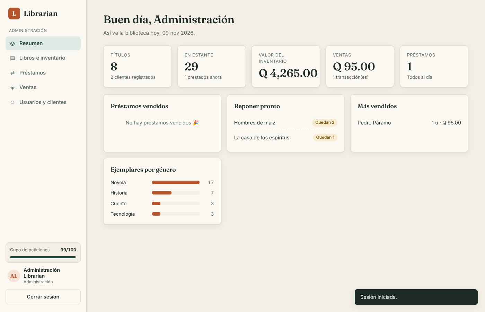
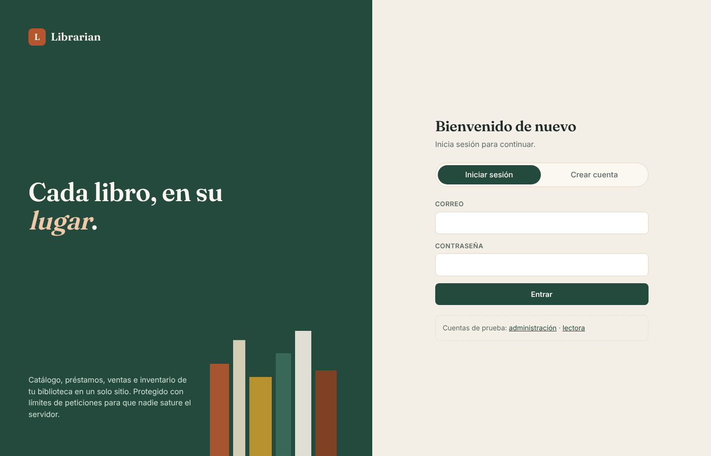
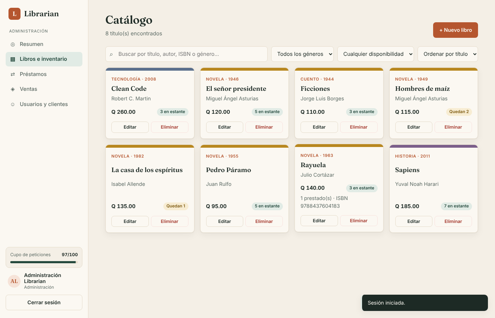
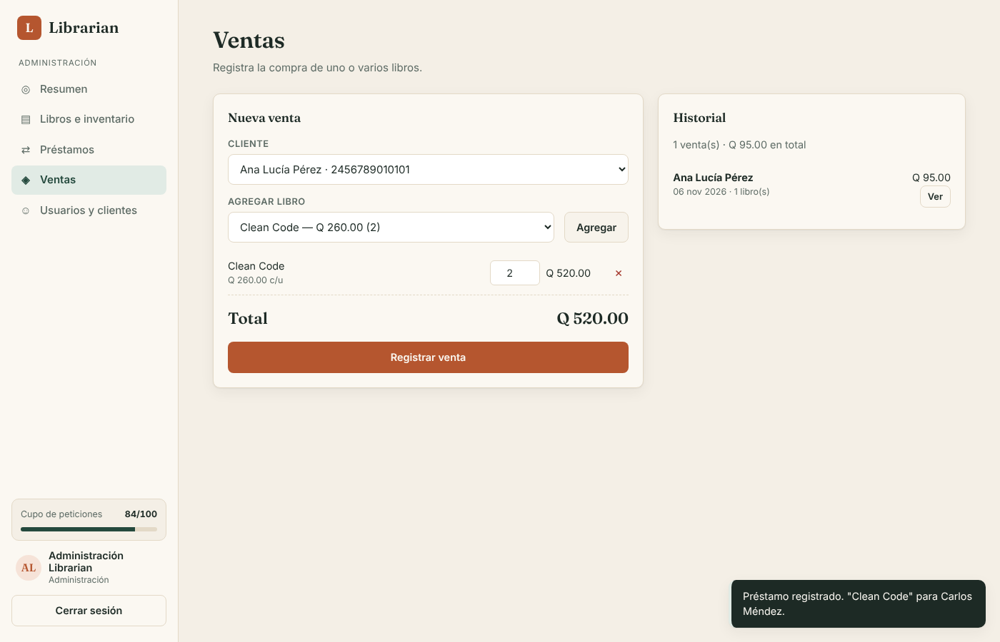
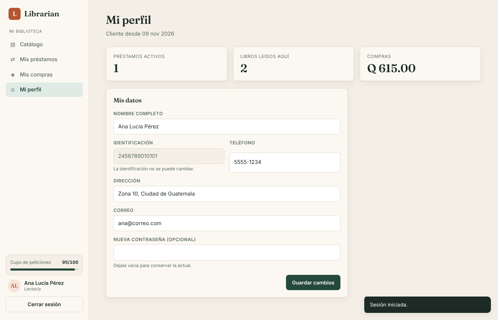

# 📚 Librarian · Frontend

Interfaz web de **Librarian**, un sistema para administrar una biblioteca-librería: catálogo e inventario de libros, préstamos, ventas y clientes. Hecha con **HTML, CSS y JavaScript sin frameworks**, servida con **Vite**.

> Este repositorio es **solo el frontend**. Necesita la API para funcionar:
> 👉 **Backend:** [allisonrvargas/review_express_backend](https://github.com/allisonrvargas/review_express_backend)



---

## 🧩 El proyecto completo

Librarian está dividido en dos aplicaciones independientes que se comunican por HTTP:

| Parte | Repositorio | Tecnología | Puerto |
| --- | --- | --- | --- |
| **Frontend** (este) | [review_express_frontend](https://github.com/allisonrvargas/review_express_frontend) | HTML · CSS · JavaScript · Vite | `5173` |
| **Backend** | [review_express_backend](https://github.com/allisonrvargas/review_express_backend) | Node.js · Express 5 · express-rate-limit · cors | `3000` |

```
┌──────────────────────┐   fetch + token Bearer    ┌──────────────────────────┐
│  FRONTEND  :5173     │ ────────────────────────▶ │  BACKEND  :3000/api      │
│  HTML · CSS · JS     │ ◀──────────────────────── │  Express + rate limit    │
│  (Vite)              │   JSON + header RateLimit │  datos en memoria        │
└──────────────────────┘                           └──────────────────────────┘
```

---

## 🚀 Instalación y ejecución

Requisito: **Node.js 20.19 o superior** (lo pide Vite). Hacen falta **dos terminales**, una para cada repositorio.

**1. Backend** (primero):

```bash
git clone https://github.com/allisonrvargas/review_express_backend.git
cd review_express_backend
npm install
npm run dev        # http://localhost:3000/api
```

**2. Frontend** (este repositorio):

```bash
git clone https://github.com/allisonrvargas/review_express_frontend.git
cd review_express_frontend
npm install
npm run dev        # abre http://localhost:5173
```

Otros comandos:

```bash
npm run build      # versión optimizada en dist/
npm run preview    # sirve la versión de dist/
```

> Si el backend no está encendido, la página lo avisa con un mensaje al intentar entrar.

### Cuentas de prueba

En la pantalla de entrada hay enlaces que llenan estas cuentas automáticamente:

| Rol | Correo | Contraseña |
| --- | --- | --- |
| Administración | `admin@librarian.gt` | `Admin123*` |
| Usuario (lectora) | `ana@correo.com` | `Lector123*` |

---

## 🖥 Pantallas

La interfaz muestra un **menú distinto según el rol** de quien inicia sesión.

### 🛠 Administración

| Pantalla | Qué permite |
| --- | --- |
| **Resumen** | Ver métricas del inventario, préstamos vencidos, libros por reponer, más vendidos y ejemplares por género. |
| **Libros e inventario** | Buscar, filtrar y ordenar el catálogo; crear, editar y eliminar libros. |
| **Préstamos** | Prestar un libro (libro, usuario, fecha de préstamo y fecha tentativa), filtrar por estado y registrar devoluciones. |
| **Ventas** | Armar un carrito con uno o varios libros para un cliente, ver el total y registrar la venta; consultar el historial. |
| **Usuarios y clientes** | Buscar clientes, registrar clientes nuevos, editar sus datos (la identificación no cambia) y ver su ficha con historial. |

### 👤 Usuario

| Pantalla | Qué permite |
| --- | --- |
| **Registrarse** | Crear su cuenta desde la pantalla de entrada. |
| **Catálogo** | Consultar libros y su disponibilidad. |
| **Mis préstamos** | Ver su historial de préstamos con fechas y estado. |
| **Mis compras** | Ver sus compras con el detalle de cada una. |
| **Mi perfil** | Editar sus datos y su contraseña. La identificación aparece bloqueada. |

| Acceso | Catálogo |
| --- | --- |
|  |  |

| Ventas | Mi perfil |
| --- | --- |
|  |  |

---

## 🔗 Conexión con el backend

- **Dirección de la API:** está en `src/api.js` y se toma de `VITE_API_URL`. Por defecto es `http://localhost:3000/api`. Para cambiarla, copia `.env.example` como `.env`.
- **Sesión:** al iniciar sesión, el [backend](https://github.com/allisonrvargas/review_express_backend) devuelve un token. El frontend lo guarda en `sessionStorage` y lo envía en cada petición como `Authorization: Bearer <token>`.
- **CORS:** el backend solo acepta peticiones de los orígenes de su variable `CORS_ORIGIN`. El puerto `5173` (Vite) ya viene autorizado. Si publicas el frontend en otra dirección, agrégala allí.

### 🛡 Medidor de cupo (rate limit)

El backend limita cuántas peticiones se pueden hacer por minuto. Cada respuesta trae el header estándar:

```
RateLimit: limit=100, remaining=87, reset=42
```

`src/api.js` lo lee en cada respuesta y el menú lateral muestra una barra con las peticiones restantes:

- **verde:** más de la mitad del cupo,
- **amarillo:** menos de la mitad,
- **rojo:** casi agotado.

Si se supera el límite, la API responde `429` y aparece un aviso con los segundos que faltan para volver a intentar.

---

## 🎨 Diseño

- **Estilo:** editorial de biblioteca, con fondo papel crema, verde bosque, acentos terracota y títulos en **Fraunces** (serif).
- **Catálogo:** tarjetas con un "lomo" de color según el género.
- **Formularios:** se abren en ventanas modales (`<dialog>` nativo).
- **Avisos:** aparecen en la esquina inferior.
- **Adaptable:** funciona en celular. En pantallas pequeñas el menú pasa arriba.
- **Seguridad:** todo dato del servidor se escapa antes de mostrarse, para evitar inyección de HTML.

---

## 🗂 Estructura

```
review_express_frontend/
├── index.html            pantalla de acceso y estructura de la app
├── vite.config.js        puerto 5173
├── .env.example          VITE_API_URL
├── docs/                 capturas para este README
└── src/
    ├── main.js           acceso, menú por rol y navegación con #rutas
    ├── api.js            llamadas a la API, token y lectura del rate limit
    ├── ui.js             avisos, modal, formatos (Q, fechas) y utilidades
    ├── estilos.css
    └── vistas/
        ├── resumen.js    tablero de administración
        ├── catalogo.js   catálogo (ambos roles)
        ├── prestamos.js  préstamos y devoluciones
        ├── ventas.js     carrito e historial de ventas
        ├── clientes.js   usuarios y clientes
        └── cuenta.js     mis préstamos, mis compras y mi perfil
```

---

Hecho por **Allison Vargas** · API en 👉 [review_express_backend](https://github.com/allisonrvargas/review_express_backend)
